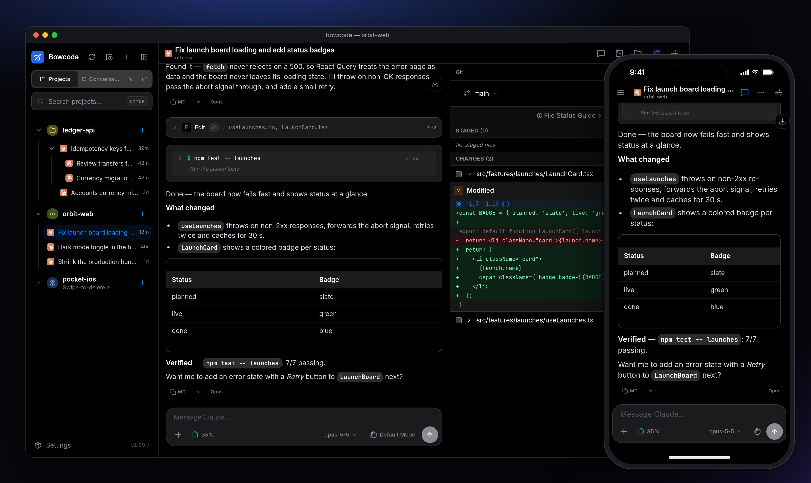
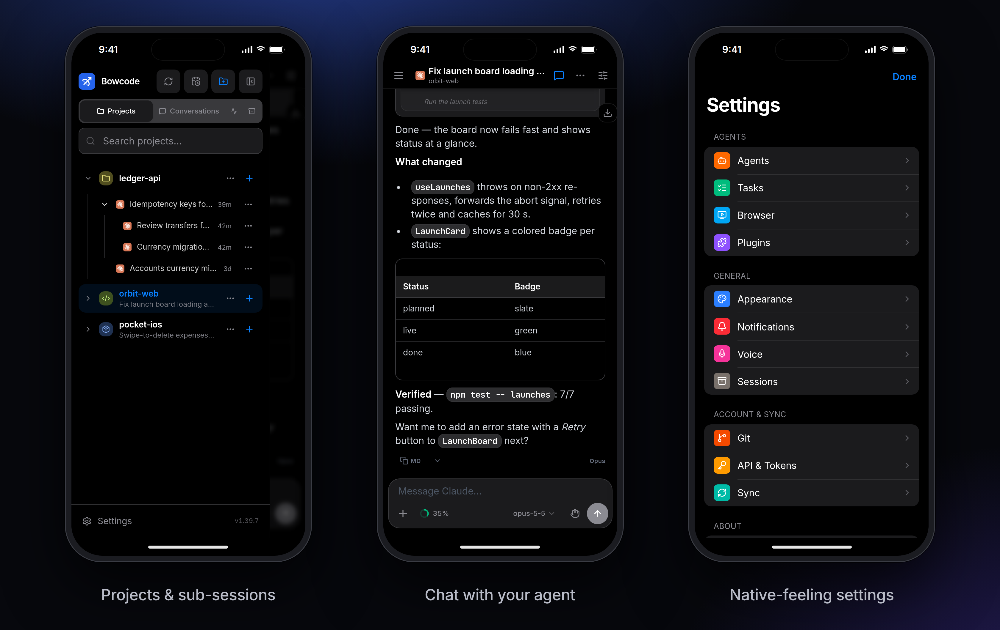
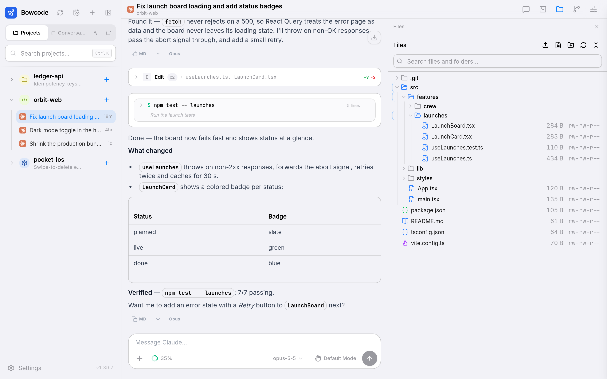
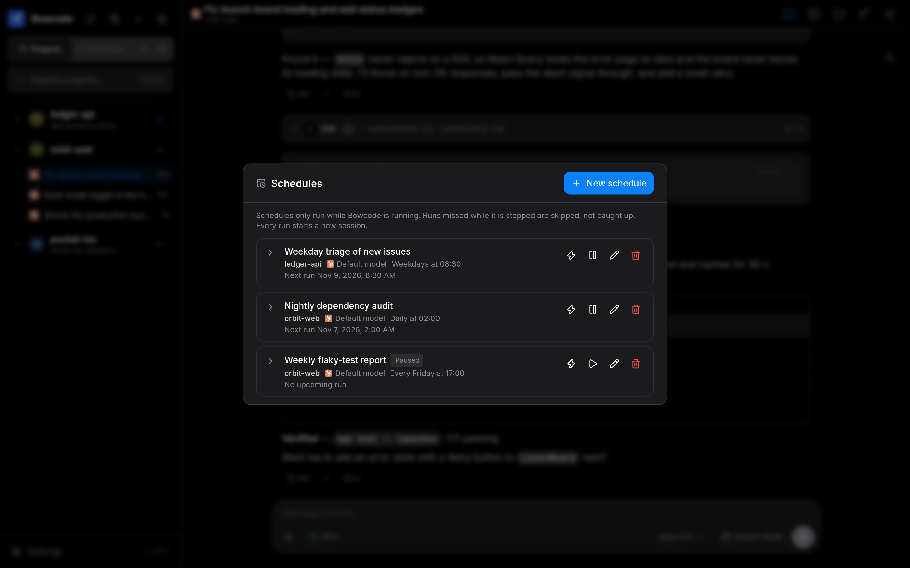
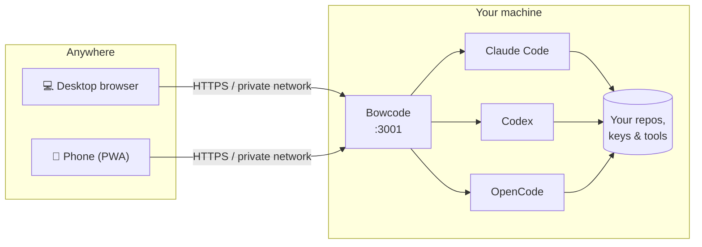

<div align="center">


# Bowcode

### Your coding agents, from anywhere.

A self-hosted web app for driving **Claude Code**, **Codex** and **OpenCode**<br>
on your own machine — from any browser, including your phone.

[](https://github.com/50xu/bowcode/releases/latest)
[](https://github.com/50xu/bowcode/actions/workflows/release.yml)


[](LICENSE)

**[Install](#-quick-start)** · [Features](#-features) · [How it works](#-how-it-works) · [Updating](#-updating) · [CLI](#-command-line) · [From source](#-run-from-source)

<br>



</div>

<br>

```bash
curl -fsSL https://raw.githubusercontent.com/50xu/bowcode/main/install.sh | bash
```

<p align="center"><sub>One line, Linux or macOS. Installs the <code>bowcode</code> command, starts it as a background service on port <code>3001</code>, and prints the address to open.</sub></p>

---

## ✨ Why Bowcode

Agents work best on the machine that has your code, keys and tools: a workstation, a home server or a cloud box. Bowcode runs on that machine and gives you a fast, polished UI for it from any browser. Start a task at your desk, check on it from your phone on the train, approve a tool call and keep going.

<table>
<tr>
<td width="33%" valign="top">

#### 🏠 Self-hosted
Your code, sessions and credentials stay on your machine. There is no Bowcode cloud and no account with us.

</td>
<td width="33%" valign="top">

#### 🔌 Bring your own agent
It drives the official CLIs you already use, with your own subscriptions or API keys.

</td>
<td width="33%" valign="top">

#### 🔒 One agent per session
Two agents never edit one session at once. Bowcode takes over from the terminal when you send from the web, steps aside when you go back, and kills a turn that hangs.

</td>
</tr>
</table>

### Supported agents

| Agent | Version | Sign-in |
|---|---|---|
| [Claude Code](https://docs.anthropic.com/en/docs/claude-code) | current | Claude subscription or API key |
| [Codex](https://github.com/openai/codex) | current | ChatGPT plan or API key |
| [OpenCode](https://opencode.ai) | **2.x** | any provider OpenCode supports |

You need at least one of them installed and signed in on the machine.

## 🚀 Features

<table>
<tr>
<td width="50%" valign="top">

### 💬 Chat that keeps up
Streaming replies, collapsible tool calls with inline diffs, tables and code, a context meter with one-tap **Compact**, queued messages and voice input.

### 🧭 Every session in one place
All projects and conversations on the machine, including sessions started in the terminal, which you can watch live. Search, star, rename and archive them. New sessions get a short **auto-generated title** in the language you wrote in.

### 🌳 Sub-sessions, nested
When an agent launches another agent (`claude -p`, `opencode run`, …), the child session is nested under its parent in the sidebar, across providers and projects, so background work never gets lost.

### ⏰ Schedules
Run a prompt on a **recurring schedule** or once at a set time, per project: presets or a raw cron expression, in your time zone, with a preview of the next runs and a history that links every run's session.

</td>
<td width="50%" valign="top">

### 🛠️ Tools beside the chat
On desktop, files, a git client (stage, commit, branches, worktrees), a full terminal and a browser open in a resizable side panel. The file tree loads lazily and searches on the server, so even a folder of large repos opens instantly.

### 📱 Built for the phone
Installs as a PWA with an iOS-style layout: safe-area aware, a keyboard-aware composer and smooth scrolling through long transcripts.

### 🔐 Your rules
Per-agent permission modes, MCP servers, skills and models, plus **web push notifications** when an agent needs you. Optionally archive or delete sessions that have been idle for N days.

### 🔄 Settings that follow you
**Sync** settings to a git repository you own and pull them on another install. Secrets are never written to the repository.

</td>
</tr>
</table>



<details>
<summary><b>More screenshots</b></summary>
<br>

| Light mode with the file tree | Schedules |
|---|---|
|  |  |

</details>

## 🧩 How it works



Bowcode is a single Node.js server. It runs the official agent CLIs on your behalf, reads the sessions they write to disk (so terminal sessions show up too) and streams everything to the browser. Its own data lives in `~/.bowcode`.

## 📦 Quick start

**Requirements:** Linux or macOS · **Node.js 22.22+** (24 or 26 recommended) · at least one [supported agent](#supported-agents)

```bash
curl -fsSL https://raw.githubusercontent.com/50xu/bowcode/main/install.sh | bash
```

1. The installer adds the `bowcode` command from the latest GitHub Release.
2. It starts Bowcode as a background service — a **systemd** user service on Linux, a **launchd** agent on macOS.
3. It prints the address. Open it, create your account, and you're in.

<details>
<summary><b>Installer options</b></summary>
<br>

```bash
# pin a version, follow the beta channel, change the port, or skip the background service
curl -fsSL https://raw.githubusercontent.com/50xu/bowcode/main/install.sh | bash -s -- \
  --version v1.39.7 --channel beta --port 8080 --no-service
```

</details>

<details>
<summary><b>Manual install (without the script)</b></summary>
<br>

```bash
npm install -g https://github.com/50xu/bowcode/releases/latest/download/bowcode.tgz \
  --allow-scripts=bowcode,bcrypt,better-sqlite3,node-pty
bowcode service install --port 3001     # or run in the foreground: bowcode start
```

On Linux, run `loginctl enable-linger $USER` once so the service keeps running after you log out.

</details>

> [!WARNING]
> **Reaching it from your phone.** Bowcode listens on your network and gives **full shell access** to the machine. For access away from home, put it behind a private network such as [Tailscale](https://tailscale.com) or a reverse proxy with HTTPS. Never expose it to the open internet without one.

## 🔄 Updating

| | |
|---|---|
| **In the app** | A dot appears on **Settings** when a new release is out. Open **Settings → About → Update now**: Bowcode updates and restarts itself, and the page reloads. |
| **From a terminal** | `bowcode update` — or `bowcode update --check` to just look. |
| **Release channel** | **Stable** by default. Switch to **Beta** in **Settings → About**, or pass `--channel beta`, to get prereleases first. |

Your data in `~/.bowcode` is kept across updates.

## ⌨️ Command line

```text
bowcode start [--port N]                    run in the foreground (the default command)
bowcode service install|uninstall|status    manage the background service
bowcode update [--check] [--channel stable|beta] [--version vX.Y.Z]
bowcode status                              show configuration and data paths
bowcode sandbox <path> [--agent claude|codex]   run in a Docker sandbox
bowcode version
bowcode help
```

## 🧑‍💻 Run from source

```bash
git clone https://github.com/50xu/bowcode.git && cd bowcode
npm ci && npm run build
npm run server          # production build on :3001
npm run dev             # or hot-reload development
```

Contributions are welcome. See [CONTRIBUTING.md](CONTRIBUTING.md), including how releases are cut (`npm run release -- minor`).

## 📄 License

Licensed under **AGPL-3.0-or-later** — see [LICENSE](LICENSE) and [NOTICE](NOTICE). Claude Code, Codex and OpenCode are third-party tools; their names belong to their owners.

<sub>Bowcode is forked and modified from [CloudCLI UI](https://github.com/siteboon/claudecodeui).</sub>
