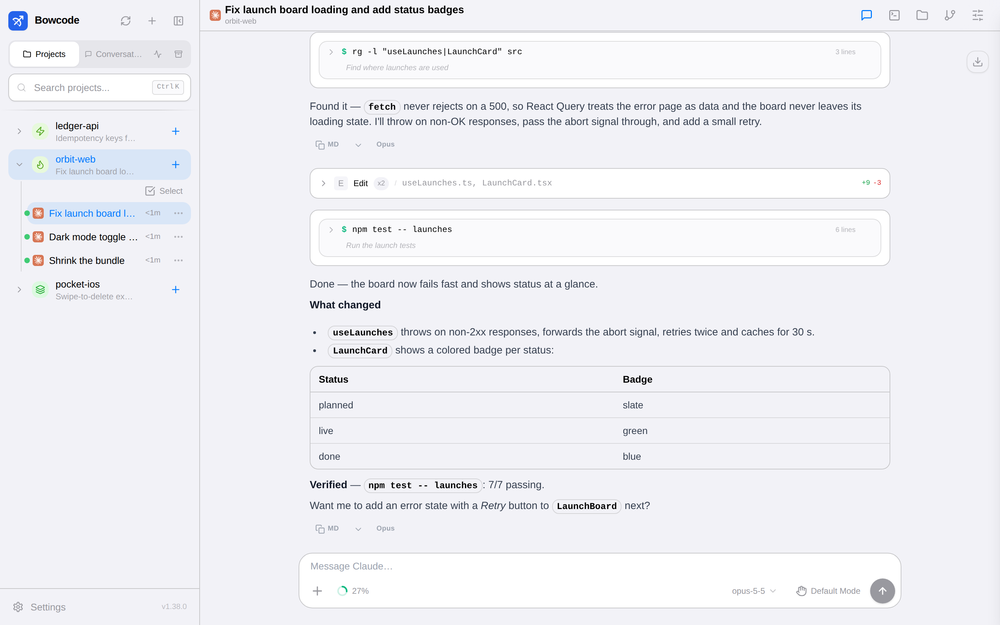
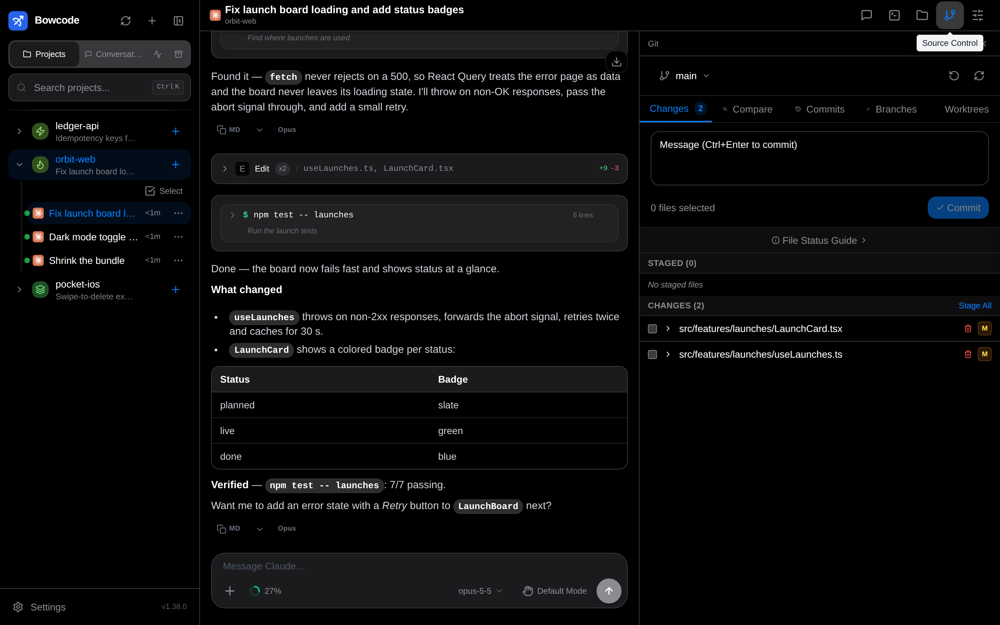

<div align="center">


# Bowcode

**Your coding agents, from anywhere.**

A self-hosted web app for driving **Claude Code**, **Codex** and **OpenCode** on your own machine from any browser, including your phone.

[](https://github.com/50xu/bowcode/releases/latest)
[](https://github.com/50xu/bowcode/actions/workflows/release.yml)

[](LICENSE)

[Install](#install) · [Features](#features) · [Update](#updating) · [From source](#run-from-source) · [License](#license)

<br>


</div>

## Why Bowcode

Agents work best on the machine that has your code, keys and tools: a workstation, a home server or a cloud box. Bowcode runs on that machine and gives you a fast, polished UI for it from any browser. You can start a task at your desk, check on it from your phone on the train, approve a tool call and keep going.

- **Self-hosted.** Your code, sessions and credentials stay on your machine. There is no Bowcode cloud and no account with us.
- **Bring your own agent.** It drives the official CLIs you already use, including Claude Code, Codex and OpenCode, with your own subscriptions or API keys.
- **One agent per session.** It refuses to start a second agent on the same session, kills one that hangs, takes over from a terminal (TUI) session when you send from the web, and steps aside when you start a turn in the terminal. Two agents never edit one session at the same time.

## Features

<table>
<tr>
<td width="50%" valign="top">

### 💬 Chat that keeps up
Streaming replies, collapsible tool calls with inline diffs, tables and code, a context meter with one-tap **Compact**, queued and scheduled messages, and voice input.

### 🧭 Projects & sessions
Every project and conversation on the machine is in one sidebar, including sessions started in the terminal, which you can watch live. You can search, star, rename and archive them.

### 🛠️ Tools beside the chat
On desktop, files, a git client (stage, commit, branches, worktrees), a full terminal and a browser open in a resizable side panel, so the chat stays in view.

</td>
<td width="50%" valign="top">

### 📱 Built for the phone
It installs as a PWA with an iOS-style layout, safe-area aware, with a keyboard-aware composer and smooth scrolling through long transcripts.

### 🔐 Your rules
Per-agent permission modes, MCP servers, skills and models, plus web push notifications when an agent needs you.

### 🔄 Settings that follow you
**Sync** settings to a git repository you own and pull them on another install. Secrets are never written to the repository.

</td>
</tr>
</table>


<details>
<summary><b>More screenshots</b></summary>
<br>

| Light mode | Git side panel |
|---|---|
|  |  |

</details>

## Install

You need **Linux or macOS**, **Node.js 22.22+** (24 or 26 recommended), and at least one agent CLI installed and signed in ([Claude Code](https://docs.anthropic.com/en/docs/claude-code), [Codex](https://github.com/openai/codex) or [OpenCode](https://opencode.ai) 2 or newer).

```bash
curl -fsSL https://raw.githubusercontent.com/50xu/bowcode/main/install.sh | bash
```

The installer:
1. installs the `bowcode` command from the latest GitHub Release;
2. starts it as a background service (a **systemd** user service on Linux, a **launchd** agent on macOS);
3. prints the address to open. Bowcode serves on port `3001` by default.

Open it, create your account, and you're in.

<details>
<summary>Installer options and manual install</summary>
<br>

```bash
# pin a version, change the port, or skip the background service
curl -fsSL https://raw.githubusercontent.com/50xu/bowcode/main/install.sh | bash -s -- --version v1.38.0 --port 8080 --no-service
```

Without the script:

```bash
npm install -g https://github.com/50xu/bowcode/releases/latest/download/bowcode.tgz \
  --allow-scripts=bowcode,bcrypt,better-sqlite3,node-pty
bowcode service install --port 3001     # or run in the foreground: bowcode start
```

On Linux, run `loginctl enable-linger $USER` once so the service keeps running after you log out.

</details>

> **Reaching it from your phone.** Bowcode listens on your network. For access away from home, put it behind a private network such as [Tailscale](https://tailscale.com) or a reverse proxy with HTTPS. Don't expose it to the open internet without one: it gives full shell access to the machine.

## Updating

| | |
|---|---|
| **In the app** | A dot appears on **Settings** when a new release is out. Open **Settings → About → Update now**: Bowcode updates and restarts itself, and the page reloads. |
| **From a terminal** | `bowcode update` (or `bowcode update --check` to just look). |

Your data lives in `~/.bowcode` and is kept across updates.

## Commands

```text
bowcode start [--port N]           run in the foreground
bowcode service install|uninstall|status
bowcode update [--check] [--version vX.Y.Z]
bowcode version
bowcode status                     show configuration and paths
```

## Run from source

```bash
git clone https://github.com/50xu/bowcode.git && cd bowcode
npm ci && npm run build
npm run server          # production build on :3001
npm run dev             # or hot-reload development
```

Contributions are welcome. See [CONTRIBUTING.md](CONTRIBUTING.md), including how releases are cut (`npm run release -- minor`).

## License

Licensed under **AGPL-3.0-or-later** — see [LICENSE](LICENSE) and [NOTICE](NOTICE). Claude Code, Codex and OpenCode are third-party tools; their names belong to their owners.

_Bowcode is forked and modified from CloudCLI UI (https://github.com/siteboon/claudecodeui)._
